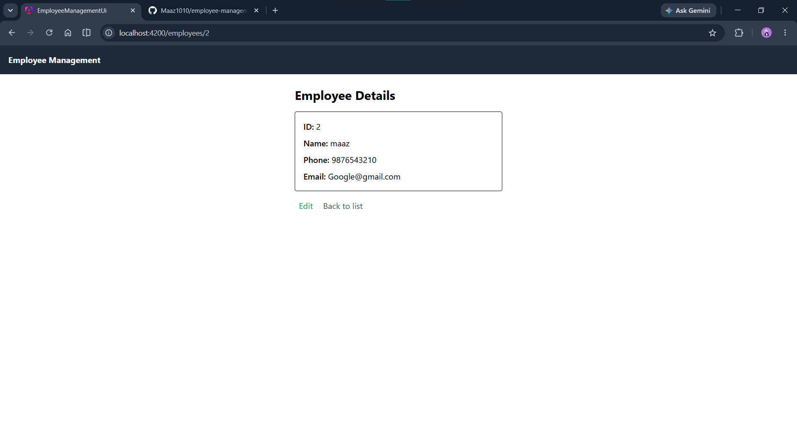
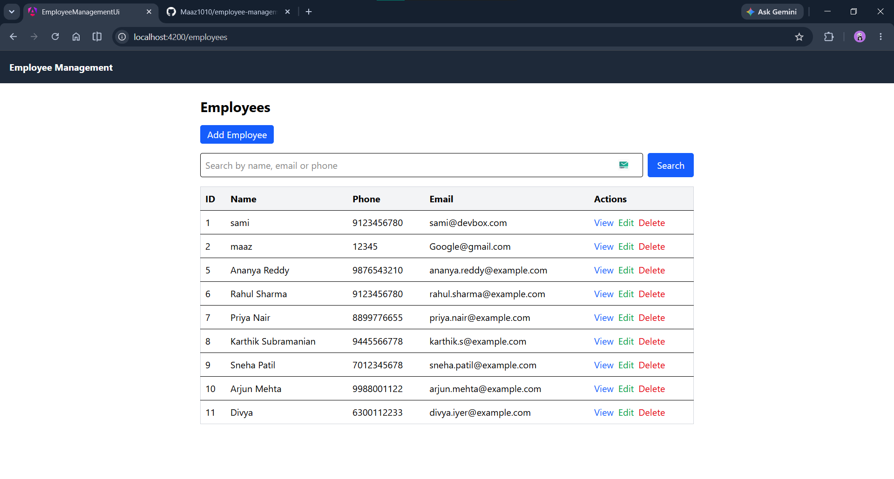
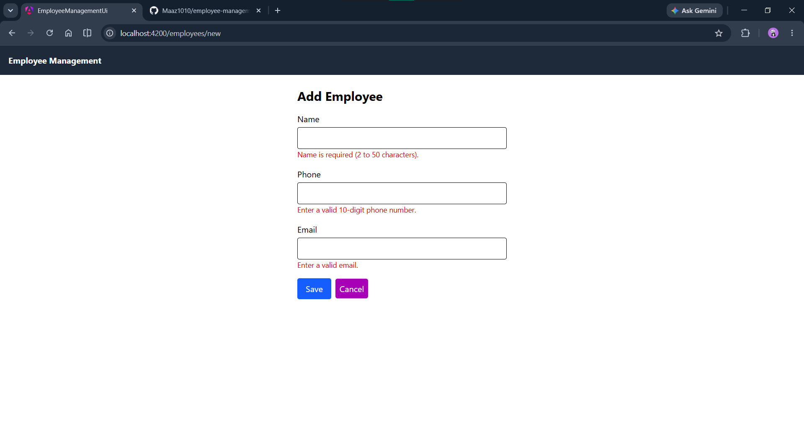

# Employee Management UI

A full-stack employee management application. This repository is the **Angular frontend**, which consumes a **Spring Boot REST API** for all data operations.

> Backend repository: [employee management backend](https://github.com/Maaz1010/employee-management-spring-boot)

## Features

- View all employees in a table
- Add a new employee
- Edit an existing employee 
- View a single employee's details
- Delete an employee with a confirmation prompt
- Search by name, email or phone 
- Form validation with clear error messages
- Loading, empty, not-found and error states on every page


## Screenshots

| Employee list | Add / edit form |
|---|---|
|  |  |

| Validation errors | 
|---|
|  | 

## Tech stack

**Frontend**
- Angular and TypeScript
- Tailwind CSS


**Backend** (separate repository)
- Java, Spring Boot
- Spring Data JPA
- MySQL

## Angular concepts used

| Concept | Where it is used |
|---|---|
| Standalone components | List, form and detail pages |
| Services and dependency injection | `EmployeeService` holds all API calls, injected with `inject()` |
| HttpClient and Observables | GET, POST, PUT and DELETE calls, handled with `subscribe` |
| Routing and route parameters | `/employees`, `/employees/new`, `/employees/:id`, `/employees/:id/edit` |
| Reactive forms | `FormBuilder`, `FormGroup`, `FormControl` and built-in validators |
| Signals and `computed` | Employee list, loading and error state, derived search results |
| Property and event binding | `[routerLink]`, `[disabled]`, `(click)`, `(keyup.enter)` |
| Control flow | `@if`, `@else if`, `@for` with `track` |
| Template reference variables | `#searchBox` for the search input |

## API endpoints used

| Method | URL | Purpose |
|---|---|---|
| GET | `/api/employees` | List all employees |
| GET | `/api/employees/{id}` | Get one employee |
| POST | `/api/employees` | Create an employee |
| PUT | `/api/employees/{id}` | Update an employee |
| DELETE | `/api/employees/{id}` | Delete an employee |


## Project structure

```
src/app/
  components/
    employee-list/      table, search, delete
    employee-form/      add and edit form
    employee-detail/    single employee view
  models/
    employee.ts         Employee interface
  services/
    employee.service.ts API calls
  app.routes.ts         route definitions
  app.config.ts         app providers (router, HttpClient)
```


